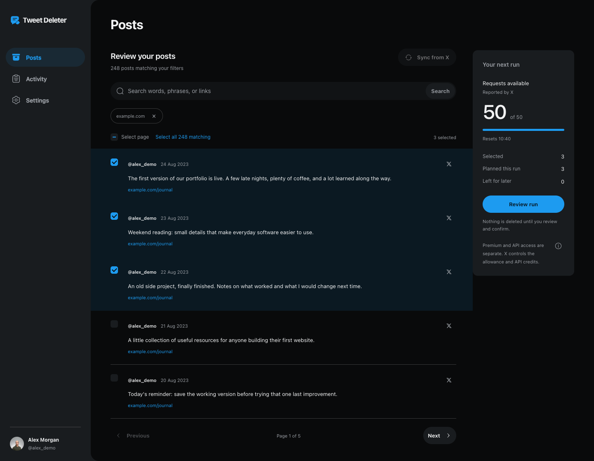
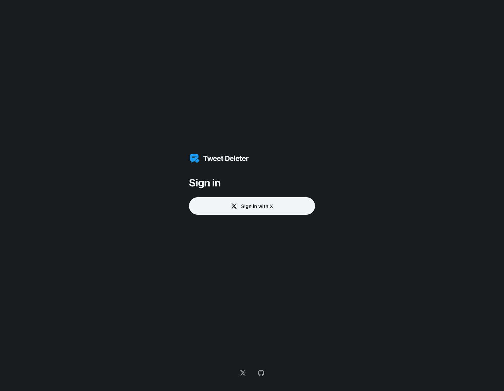
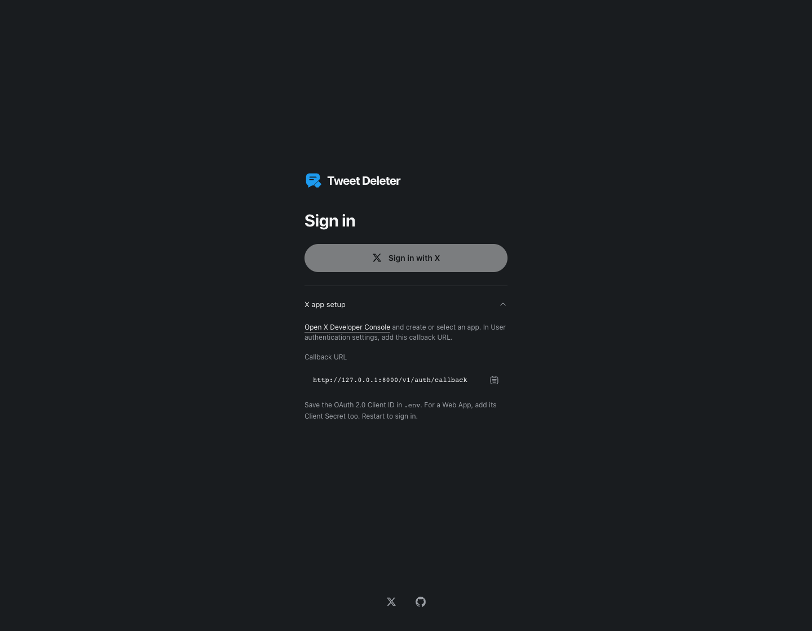
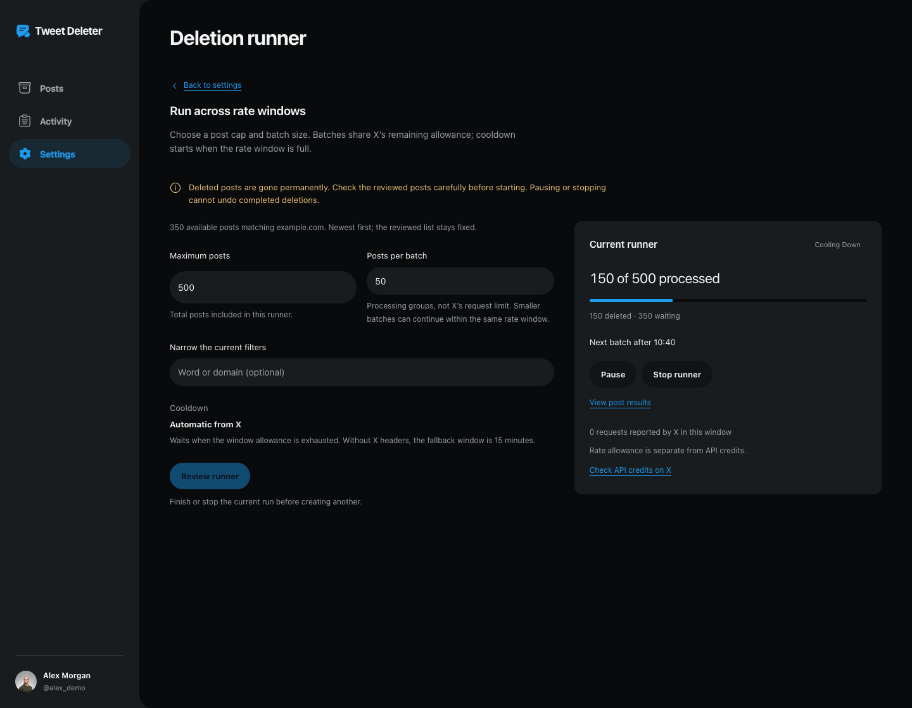
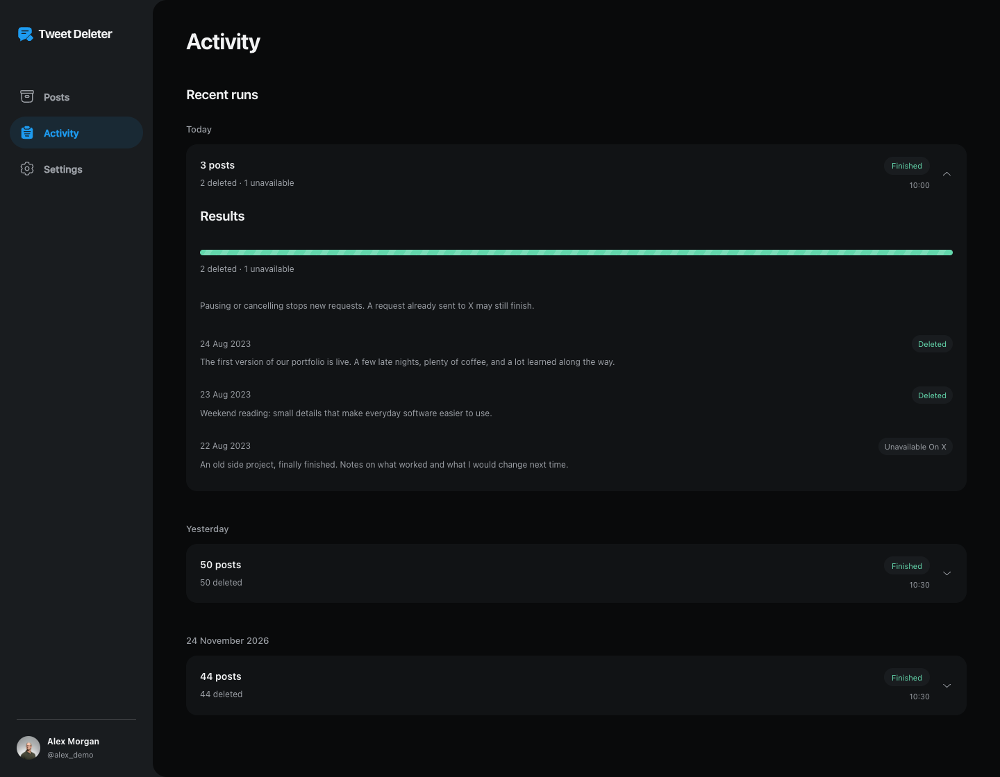

# Tweet Deleter

[](CHANGELOG.md)
[](https://www.python.org/downloads/)
[](https://fastapi.tiangolo.com/)
[](https://www.sqlite.org/)
[](LICENSE)

Delete selected posts from your X account using a local archive. Filter by words
or domains, review the selection, and run the app on your computer or your own server.

**X API requests cost credits.** This app is free to use, but X's API is a separate
service. Funding your Developer account may be necessary for deletion as well as
reading posts. X Premium does not include API credits. Check
[X's pricing](https://docs.x.com/x-api/getting-started/pricing) and your
[Developer Console](https://console.x.com/) for current charges and limits.



Screenshots use a demo account and sample posts.

<table>
  <tr>
    <td width="50%">
      <strong>Sign in</strong><br />
      
    </td>
    <td width="50%">
      <strong>X app setup</strong><br />
      
    </td>
  </tr>
  <tr>
    <td width="50%">
      <strong>Deletion runner</strong><br />
      
    </td>
    <td width="50%">
      <strong>Activity</strong><br />
      
    </td>
  </tr>
</table>

## What you can do

- Import `tweets.js` and search or filter posts locally.
- Select individual posts, a page, or all matches.
- Review how many fit in the next run before confirming deletion.
- Pause a run and keep its results across restarts.
- Browse history by date, expand a run, and see each post's outcome.
- Optionally load posts from X when you do not have an archive.

Post reads are **off by default**. Deleting archive posts sends their saved IDs
straight to X; it does not fetch a timeline or check each post first. This avoids
post-read requests, but does not make deletion free.

## Get started

You need Python 3.12 or newer, `make`, and an X Developer app. The launcher supports macOS
and Linux. Starting the app needs no Node process or separate database server.

See [INSTALL.md](INSTALL.md) for full requirements, Ubuntu, Windows through WSL,
HTTPS hosting, aaPanel/cPanel setup and backup instructions.

```sh
git clone https://github.com/Ennygabby01/delete_tweets.git
cd delete_tweets
make setup
```

To select an interpreter explicitly, use `make setup PYTHON=python3.14` (or another
installed Python 3.12+ interpreter).

Setup creates `.venv` and a private `.env`. Add your app's **OAuth 2.0 Client ID**
and **Client Secret** there. Keep the generated encryption key.

```dotenv
X_CLIENT_ID=your-client-id
X_CLIENT_SECRET=your-client-secret
```

In X Developer Console, open your app's **User authentication settings**:

1. Enable OAuth 2.0 and select **Web App / Automated App / Bot**.
2. Select **Read and Write** where offered.
3. Register the callback URL printed by the launcher. At the default port it is
   `http://127.0.0.1:8000/v1/auth/callback`.

```sh
make start
```

Open the address printed in the terminal and sign in with X. Authorization uses
the current tab and returns to the app. The first verified account becomes the
owner of a local installation. HTTPS hosting requires a configured owner account ID.

Both the frontend and API run from this command. If port 8000 is busy, the launcher
reserves another loopback port and prints its address and callback. Register that
exact callback in your X app before signing in.

```sh
make start PORT=8001   # Prefer a different port
make dev               # Reload Python changes during development
```

Press **Ctrl+C** to stop. With `make dev`, refresh the page after static file changes.

## Import and delete

Request your archive from **X → Settings and privacy → Your account → Download an
archive of your data**. Extract it and find `data/tweets.js`.

1. Open **Settings** in Tweet Deleter and import the file.
2. Add domain or keyword filters if needed. With no filters, all available posts
   appear. Search narrows the current view.
3. Choose **Newest first** or **Oldest first** under **Settings → Filters → Post order**.
   This controls the post list and new run previews. Reviewed runs keep their saved order.
4. Select posts. On desktop, the next-run panel stays beside the list. On smaller
   screens, the floating tool button opens it in a drawer.
5. Choose **Review run**, check the count, and type `DELETE` to confirm.

Deletion is permanent. A post already missing from X is marked **unavailable**,
not counted as a new deletion. A timeout can leave the result **uncertain**; the
app will not silently send that deletion again.

Activity groups runs by date. Expand a row for progress, post outcomes and controls.
Closing the browser does not erase a confirmed run. Stopping the server pauses
work; review interrupted results before continuing.

## Deletion runner

Open **Settings → Developer tools → Open deletion runner** to work across multiple
rate windows. For example, set a maximum of 500 posts and batches of 50.

The runner uses your current filters, optional search and saved post order. Review the
fixed list of included posts, then type `DELETE` to start. New imports or filter
changes do not add posts to an already reviewed runner. Its cap limits distinct
posts; unavailable or failed posts are not replaced to fill the cap.

**Deleted posts cannot be recovered.** Pause or stop the runner from its progress
panel or Activity. One request already in flight may still finish. Stopping does
not undo deletions. Keep the app server running; the browser may be closed.
Restarting the server pauses the runner and requires review before resuming.
Use `make start` for unattended runs: `make dev` reloads after source changes and
those reloads also pause the runner.

X's saved rate-limit headers determine the cooldown. When unavailable, the app uses
its labelled fallback (`X_DELETE_WINDOW_SECONDS`, 15 minutes by default). Batch
size groups the work; it does not lower X's window allowance. For example, two
batches of 25 can finish in one window when 50 requests remain. The runner waits
only when that allowance is exhausted or X returns a rate-limit response. Scheduled runs
wait out rate limits automatically; billing, permissions and uncertain outcomes
pause for your intervention. Ordinary single runs still pause on rate limits.

The displayed allowance is **requests in a rate window, not posts affordable with
your credit balance**. No credit-balance polling or extra provider reads are added.
Check credits in [Developer Console](https://console.x.com/).

## Choose whether to allow reads

Open **Settings → X connection → Allow X post reads**.

- **Off:** use the archive, filters and local history. Sync and uncertain-result
  lookups are blocked by the backend.
- **On:** allow manual sync, older-page loading and checks of uncertain results.
  These actions can use API credits. Enabling the switch does not start a fetch.

A read already in progress can finish before the switch turns off. Account
verification during sign-in is separate from post reading. Profile photos are
requested during sign-in, not repeatedly during workspace refreshes.

X's recent timeline has a limited history window; an archive can provide older IDs.
Not seeing an archive post in a limited timeline does not prove it was deleted.

## Limits and connection problems

The next-run count uses X's rate-limit headers when available, with a conservative
estimate before a response is received. It is not a credit-balance display. The app
pauses on a rate limit, billing denial or access failure instead of retrying blindly.
Changing API clients does not remove X's charges or increase your allowance.

- **Billing denied:** check credits and billing access in Developer Console.
- **App access denied:** check the app's access and write permissions.
- **Authorization needs renewal:** use **Reconnect X** in Settings.
- **Uncertain deletion:** enable post reads, check its result, then review before retrying.

Sessions expire after inactivity and have a separate maximum lifetime. Scrolling,
touch and keyboard activity count as use; background polling does not keep a
session alive indefinitely. Temporary connection failures do not themselves log
you out. Session limits and other settings are listed in [.env.example](.env.example).

## Your data

The archive, settings, history and credentials stay on the machine running the app,
in the ignored `data/` directory and `.env`. X receives authorization requests,
deletion IDs and any reads you allow.
The browser may load your profile photo from X's image CDN. There is no analytics
or tracking service in the app.

OAuth tokens are encrypted at rest. Post text and history are not. Whoever operates
the server controls its files and encryption key; this encryption does not prevent
that operator from accessing saved tokens. Use a machine and hosting provider you
trust. Never commit `.env`, `data/` or original archive and credential files.

For backup, stop the app and privately copy **the entire data directory and its
matching `.env`**. Keep them together: losing the encryption key prevents unlocking
saved credentials. On another computer, rebuild `.venv` with `make setup`.

Coming from v1? Keep your original files. The first startup copies root `tweets.js`
and `filters.json` into SQLite. Old `credentials.json` is preserved, but v2 requires
X sign-in. Existing schema-v1/v2 databases are backed up under `data/backups/` before upgrading
to schema v3, which stores runner pacing. Keep the backup with its matching `.env`.

This is a personal, single-account app, including when hosted on a public domain.
There are no consumer registrations or shared workspaces. See
[HTTPS hosting](INSTALL.md#public-https-hosting) or use a private SSH tunnel.

## Development

```sh
make setup-dev
make check
make test
make audit
```

Version and Python badges refresh from project metadata during `make check`.
Use `make badges` to refresh them separately; CI checks that the results are committed.

Frontend checks and browserless tests need Node 24.15+. Tests use temporary SQLite
databases and mocked X responses; they do not delete real posts. See
[CHANGELOG.md](CHANGELOG.md) for version history.

CI runs the locked setup, source checks, synthetic tests and dependency audit on
Ubuntu with Python 3.12 and 3.15. It uses read-only repository permissions and no X
credentials. Workflow changes take effect after they are pushed to GitHub.

## License and credits

Copyright © 2026 [GBT3K](https://github.com/Ennygabby01). Released under the
[MIT License](LICENSE). You can use, change and share the code while retaining
its copyright and license notice.

Control icons are from Solar Icons via SVGRepo, with separate licenses and brand
attributions in [static/ICONS.md](static/ICONS.md). X and GitHub marks belong to
their respective owners. Badge logo sources are listed in
[docs/badges/ICONS.md](docs/badges/ICONS.md). This project is not affiliated with X.
